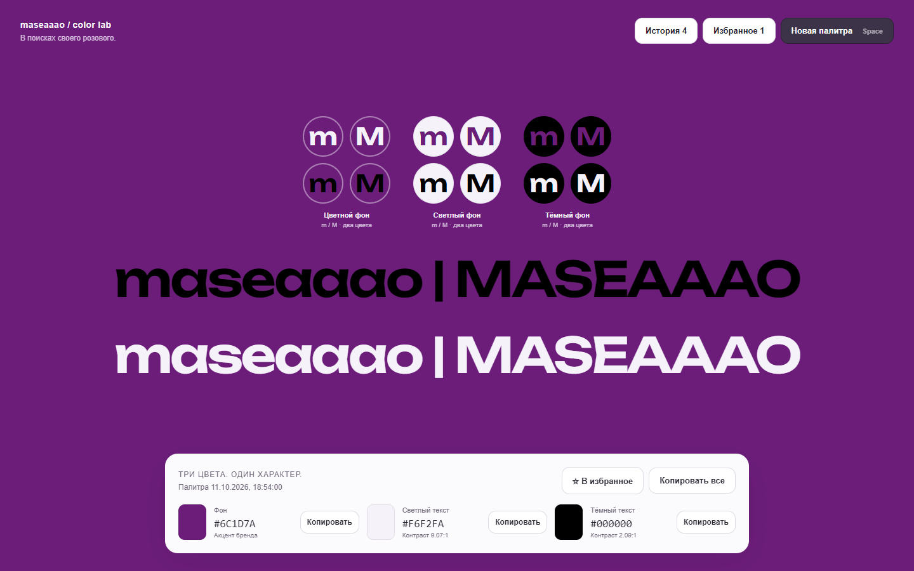

> Development now lives in `maseaaao/maseaaao.tv`, under `apps/brand-color-lab`. Start with the repository README and `docs/local-installation.md`. Historical release links and setup notes below are retained for reference.

# Get Brand Colors 🎨

A small, offline color playground for finding a brand accent. Explore pink, raspberry, red and purple palettes, compare wordmarks and round avatars, and keep the combinations you like.



## Try it

**[Open the live app](https://maseaaao.github.io/get-brand-colors/)** — hosted on GitHub Pages.

Download the repository and open **`index.html`** in a modern browser. No installation, server, account or internet connection is required. The Unbounded font and emoji favicon are embedded in the HTML.

- Generate a new palette with **New palette / «Новая палитра»** or **Space**.
- Compare dark and light `maseaaao | MASEAAAO` wordmarks at 75% of the window width.
- Preview 12 round avatars: three backgrounds × two other text colors × lowercase `m` / uppercase `M`.
- Copy any HEX value or all three colors with their labels.
- Revisit palettes in **History / «История»** and save favorites with **«В избранное»**.
- Press **Enter** to toggle the current palette’s favorite status. Buttons and input fields retain their usual Enter behavior; holding the key does not repeat the toggle.
- Export and import the history as JSON, including favorites. In the Favorites tab, the same buttons export only favorites or import palettes as favorites. Existing IDs are marked as favorites without replacing their colors; repeated imports do not create duplicates.

The interface is in Russian. To preview your own name, edit the wordmarks in the HTML and the preview text in `renderHistory()`. Change `['m', 'M']` in `renderAvatars()` to customize avatar initials. Text sizing updates automatically.

## How colors are chosen

Background hues span 270°–368° (wrapping at 360°), with 35–100% saturation and 9–92% HSL lightness. Light and dark text are selected separately from tinted candidates. The algorithm aims for a luminance contrast ratio of 7:1; when that is not possible, it selects the strongest contrast on the corresponding light or dark side, including white or black.

The contrast labels smoothly change from red at 1:1 through amber at 4.5:1 to green at 7:1 and above, using WCAG thresholds for normal text as reference points. Hover over a label for its rating. The indicator shades remain readable on the light panel.

The displayed ratios help compare options. A single background cannot always provide strong contrast for both light and dark text.

## Your data

There is no analytics, tracking or network request. History and favorites are stored in the browser's IndexedDB, with localStorage as a fallback. The lists render only visible preview cards; palette records are loaded into memory when the app opens.

Keep the HTML at a stable path and use the same browser. Moving it, clearing browser data or using private browsing may affect persistence. Export your history before moving the app or clearing data. If storage is unavailable or full, the app displays a message and keeps the current session in memory.

The hosted app has its own browser storage. To move palettes from a local HTML file to the website, export the local history and import it into the hosted app.

Imports merge new records by ID without duplicates. Existing records keep their current favorite status. Older exports without favorite flags remain supported. The import limit is 20 MB.

## Development

The app is a single HTML file with plain CSS and JavaScript. There is no build step or production dependency. Node.js 22 or later is needed only for formatting and browser checks.

```sh
npm ci
npx playwright install chromium
npm test
npm run format:check
```

Use `npm run format` to format the source. Browser checks cover generation, favorite persistence, history selection, export/import, virtual scrolling and responsive layouts. They use an isolated browser context and never read your normal browser history. For an existing Chromium installation, set `BROWSER_EXECUTABLE_PATH` to its executable path.

GitHub Pages publishes the repository root from `main`. The `.nojekyll` file keeps publication static, without Jekyll processing. Updates to `main` are published automatically.

## Contributing

Issues and pull requests are welcome. See [CONTRIBUTING.md](CONTRIBUTING.md) for the short checklist.

## License

Application code and documentation: [MIT](LICENSE), copyright © 2026 maseaaao.

The embedded **Unbounded** font is copyright © 2022 The Unbounded Project Authors and distributed under the [SIL Open Font License 1.1](licenses/Unbounded-OFL.txt). It retains that license independently of the application. See [THIRD_PARTY_NOTICES.md](THIRD_PARTY_NOTICES.md).
