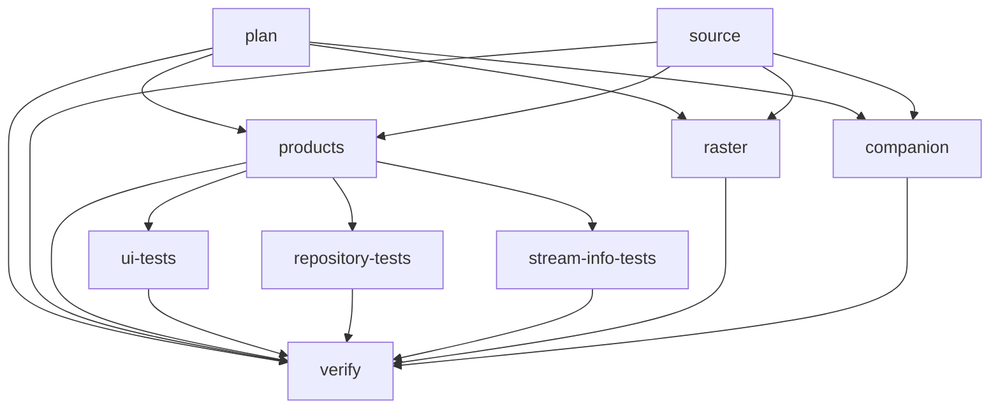

# CI/CD: stages, кеши и артефакты

GitHub Actions использует DAG через `needs`, а не отдельный синтаксис `stages`.
Все jobs работают в Linux. Версии Node/Bun, браузер, эталон растров и живые
Windows-приложения этим рефакторингом не меняются.

## Verify monorepo

`products`, `raster`, `companion` требуют **и plan, и source**. В диаграмме
показаны фазы; полный список рёбер задаёт `.github/workflows/verify.yml`.

| Job                 | Ответственность                                                                      |
| ------------------- | ------------------------------------------------------------------------------------ |
| `plan`              | Только pinned Node и Git: отбор products/raster/companion, без install               |
| `source`            | Biome, source policy, типы, инварианты, release/local и CI-контракты                 |
| `products`          | Однократная подготовка всех продуктов/UI, repository и byte checks, архив для tests  |
| `ui-tests`          | Storybook, UI portability и static fixtures последовательно                          |
| `repository-tests`  | Все `tests/*.test.mjs`, три изолированных runner; внутри shard файлы последовательны |
| `stream-info-tests` | Vitest и C#-проверки Stream Info                                                     |
| `raster`            | Реальный рендер, сборка после рендера, полная побайтовая сверка                      |
| `companion`         | Mocks, Linux-кросс-компиляция helpers, TGZ, проверка состава/install payload         |
| `verify`            | Единственный итоговый fail-closed gate всех выбранных jobs, включая matrix           |

При push сравниваются **before..HEAD**, при PR — **base...HEAD** от общего
предка. Force push не скрывает удаления файлов старой вершины. Недоступная,
нулевая или неверная база, неизвестный root/tooling path выбирают полный прогон.
Ручной и еженедельный запуски — полные. Документация не запускает тяжёлые jobs,
но `source` остаётся обязательным. Отбор пока по контурам, не по отдельному
продукту: например, изменение Tuna выбирает общий products-контур.

Разбиение файлов детерминировано и проверяется на полноту/отсутствие пересечений.
Тесты, пересобирающие общий `dist`, нельзя параллелить **в одном checkout**.
Три shards используют разные checkout и получают один и тот же build artifact.
`fail-fast: false` позволяет получить диагностику остальных shards при сбое одного.
Companion mocks выполняются в Companion job, либо в shard 1 при products-only
изменении; local mocks — в source. .NET setup нужен только C# и Companion jobs.
Небольшие инфраструктурные контракты дополнительно повторяются общим repository
набором: исключения по именам файлов не вводились, чтобы новые тесты не терялись.

## Владение кешами

| Кеш                                  | Владелец записи                         | Условия восстановления/записи                                                   |
| ------------------------------------ | --------------------------------------- | ------------------------------------------------------------------------------- |
| Bun downloads `~/.bun/install/cache` | `source`                                | OS/arch + Node/Bun/lock; restore перед frozen install, save сразу после install |
| Turbo `.build-cache/turbo`           | Отдельно `source`, `products`, `raster` | Изолированные lanes, OS/arch + версии/lock/Turbo/launcher + SHA/run/attempt     |

`.github/actions/setup` не пишет Turbo cache. `.github/actions/task-cache`
явно разделяет restore/save. `plan` и consumers не могут первыми занять ключ
полупустым task cache. Сохранение идёт после успешной task-фазы, **до** более
поздних тестов и byte checks: их ошибка не уничтожает уже выполненную работу.
Префиксы restore не пересекают lane/toolchain; новое выполнение получает новый
ключ, а не пытается дописать неизменяемую запись GitHub cache.

`node_modules`, тесты, raster outputs, TGZ/ZIP и состояние live-приложений не
кешируются. Кеш не используется вместо job artifacts и не является условием
успеха: при cache miss всегда выполняются frozen install и нужные задачи.
Старые кеши не удаляются этим workflow. Доступность и вытеснение кешей остаются
политикой GitHub; гарантии вечного хранения нет. Chromium и дополнительные
Python/.NET зависимости устанавливаются явно там, где нужны; их новые кеши не
добавлялись без замера стоимости восстановления и совместимости среды.

## Артефакты

- `ci-products` (3 дня): обязательный `ci-products.tar` только после успешной
  сборки и byte checks. Содержит корневой/site и все standalone outputs,
  Streamer.bot import, подготовленные artwork, Storybook, UI/static fixtures.
  Tar сохраняет точные пути, hidden files и mode bits. Consumers проверяют
  читаемость архива, удаляют старые output-каталоги и распаковывают свежий набор;
  старые chunks из checkout не могут случайно пережить перенос. Отсутствующий
  artifact — ошибка, возврата к tracked `dist` или кешу нет.
- `standalone-tools` (7 дней): диагностические HTML/CSS/JS, даже после сбоя.
- `website-and-artwork-preview` (7 дней): полный набор для разбора расхождения
  baseline, включая `.well-known`, все tracked продукты/растры и SHA-256 manifest.
  `raster` сохраняет полную `build:all` намеренно: набор должен быть пригоден для
  штатного `accept:artifacts`, а не частично принимать чужие tracked outputs.
- `companion-modules` (7 дней): TGZ только после проверки состава и payload.

Диагностический artifact не означает зелёную проверку. CI не принимает baseline
автоматически и ничего не коммитит. При deliberate drift применяется отдельная
процедура [приёмки растров](raster-baseline.md).

## Релизы и границы автоматизации

Релизный workflow отделён от Verify. Триггер — существующий product tag, либо
ручной запуск с тегом. План проверяет продукт/версию/CHANGELOG до Bun install,
фиксирует commit тега и выбирает toolchains из manifest. Сборка и тесты работают
с read-only permissions; привилегированная фаза получает готовый пакет своего
run, не пересобирает продукт и не использует произвольный artifact другого run.

Автоматизация по тегу заканчивается **проверенным draft**. Опциональный флаг
`publish` ручного запуска по умолчанию выключен; он разрешает публикацию нового
релиза только после проверки скачанных байтов. Существующий draft/release не
перезаписывается и не дополняется. Версии/теги автоматически не создаются,
Cloudflare и live runtime не обновляются. Подробности: [выпуски](releasing.md).

## Локальная проверка и ограничения

Изменения проверяются в отдельных visible WSL worktrees с собственным
`bun install --frozen-lockfile`, без общего `node_modules`. Проверяются реальные
build → tar → restore → shards, UI, C#, Companion build/package, raster render,
release-контракты и actionlint. Fake `gh` предназначен только для проверки
отказов/порядка релизных операций, а не для имитации опубликованного релиза.

Локальный успех не равен запуску Actions: сетевой upload/download, доступность
cache и время ожидания GitHub runners подтверждаются только будущим разрешённым
прогоном. Сравнивать времена нужно отдельно для wall-clock и суммарных
runner-minutes: больше параллельных jobs сокращают критический путь, но могут
увеличить стоимость setup/install. Без push новые workflow на GitHub не запускались.

### Проверенный локальный срез

На исходном `e50d079` полный `check`, `verify:products`, `test:checks` и
`check:artifacts` прошли в отдельном чистом worktree. С предложенными изменениями
в новых worktrees прошли `check`, все продукты, реальный tar/restore и
**208/208 repository-тестов** (82/45/81 по shards),
Storybook 62/62, Stream Info 97/97 + C# suites, UI/static, local/Companion mocks,
release Node/Python contracts и реальная сборка/упаковка/проверка Tuna.
Полный рендер и проверка 93 tracked outputs, сборка двух helpers/TGZ и проверка
состава архивов также прошли; baseline и live runtime не изменялись.

Только repository-набор: исходный последовательный прогон занял 110.7 с;
три новых shards — 46.86, 31.78, 41.95 с
(max 46.9 с при одновременном запуске).
Это не время всего CI и не прогноз Actions: глобальные download/browser caches
у локального окружения уже были, установка dependencies выполнена отдельно в
каждом новом worktree. Проверка `actionlint` — 1.7.12; сетевые release writes
не выполнялись, adverse сценарии проверены подставным `gh`.
